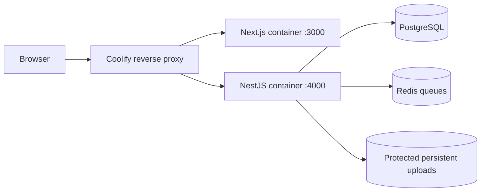

# Falcon Campus OS — Deployment Guide

This guide describes the repository's guarded, prebuilt-image deployment model.
It does not authorize a deployment, database operation, data copy, or hosting
change. Start with [STAGING_READINESS.md](./STAGING_READINESS.md) for the current
staging status, owners and outstanding approvals. Staging is not operational just
because a branch or this documentation exists.

The source baseline for this documentation change is staging commit `efd46fb4`.
Main has advanced independently; review the selected release's code, schema,
grants, tests and operations instructions together before any promotion. Do not
merge main into staging or dispatch a production workflow merely to follow this
guide. No hosting configuration or live database state was verified by this
documentation change.

## 1. Release authority and stop conditions

A senior maintainer and the infrastructure/database owners must approve the exact
source revision, image digests, target and database plan before execution.
[ROLLOUT.md](../ops/deployment-safety/ROLLOUT.md) and
[ROLLOUT_OPERATIONS.md](../ops/deployment-safety/ROLLOUT_OPERATIONS.md) describe the
existing production boundaries and host-specific adoption procedure. They take
precedence over older host-build or startup-migration recipes. Their existing-host
helpers are not a turnkey provisioner for a new staging server.

Stop before enabling automation or releasing if any of these remain unresolved:

- The hosting owner has not checked actual Coolify application sources, watched
  branches/tags, automatic-deploy settings, webhooks and deployment commands.
  Publishing an image or moving a tag may be observed by downstream automation.
- The exact revision lacks successful required CI and team approval, or source,
  schema, grants, mounts and rollback images have not been reviewed together.
- Staging can reach production databases, Redis queues, uploads, storage buckets,
  authentication secrets or live integration accounts.
- A new database has no approved complete baseline and synthetic fixtures, or a
  migration/reset/import is being proposed without target verification and a
  reviewed recovery sequence.
- Required host policy, storage permissions, resource headroom, HTTPS, backups or
  runtime-role checks are missing. Do not bypass a refusal by overriding startup.

On 30 October 2026, repository inspection found no protection rules configured
for the GitHub `production` environment. Its name alone is not an approval gate.
An administrator must review **Settings → Environments → production**, configure
required reviewers and permitted deployment branches where the account supports
these controls, and verify the resulting gate with the senior maintainer. The
image publisher does not reference this environment, so environment protection
alone does not gate publishing. These settings and the active production
workflows are not changed by this documentation update.

## 2. Architecture and image contract



Object storage and external services depend on the selected feature's configured
integration; their presence in source is not proof of an active deployment.
Staging requires separate PostgreSQL, Redis and upload/storage resources, secrets,
network boundaries and integration sandboxes. A new tenant in production is not
an isolated staging environment. Do not change production DNS to create staging.

The root `docker-compose.yml` is a local development dependency stack, not a
production or hosted staging deployment. It contains PostgreSQL 16 and local-only
defaults; the hardened database privilege policy uses PostgreSQL 18 features.
Use a separately provisioned PostgreSQL 18 target for guarded staging acceptance.
The Compose file does not start the frontend or backend. See
[DEVELOPER_GUIDE.md](./DEVELOPER_GUIDE.md) for local development.

| Component | Source | Image runtime command | Container port |
| --- | --- | --- | --- |
| API | `backend/Dockerfile` | `node scripts/runtime-start.cjs` | 4000 |
| Web | `frontend/Dockerfile` | `node server.js` | 3000 |

Build the reviewed source in CI and use the resulting images in Coolify's Docker
image configuration. The Dockerfile base directories are build contexts, not an
instruction to build on the production host. Record the full source SHA and both
registry digests. A `sha-<commit>` tag identifies source intent but can be
republished; a digest identifies the exact artifact. Do not use `main-candidate`
as an unreviewed release selector.

The API image uses Node 20 Alpine and UID/GID `61001:61001`, with root-owned code
without write bits. Its startup checks the root-controlled, read-only
`/run/falcon/storage-boundary.json`, actual upload mount identity/access, configured
database identity and policy-enabled permission checks before importing Nest. It requires
`NODE_ENV=production` and `DB_SYNCHRONIZE=false` and rejects `MIGRATION_DB_*` in the
API environment. It **never runs migrations or initializes storage**.

Provide a separately reviewed policy for the actual staging resources. Do not copy
production mount IDs/inodes or weaken enforcement to make startup succeed. Prove
upload access for the image's numeric identity, backup access and outsider denial.
Do not recursively change production ownership or permissions. After a healthy
compatible guarded image exists, the documented resource preflight is
`node scripts/resource-boundary.cjs`; installing it is an operator action subject
to the approved host procedure.

Keep the image's default command. `npm run start:prod` and direct `node dist/main.js`
bypass the launcher and are not production/staging deployment instructions.
Do not override them with PM2 or a shell that migrates before starting the API.

## 3. Database preparation and migration review

Database preparation is an explicitly approved maintenance task, separate from
publishing images, replacing containers and application startup. There is no
approved automatic staging baseline, seed or reset facility in this guide.

### New staging database

Before any write, the database and infrastructure owners must approve:

1. A pinned source revision and a complete schema baseline, including extensions,
   constraints, indexes, functions, all eight reporting materialized views and
   required non-sensitive reference data. TypeORM synchronization is not proof of
   that complete baseline and is forbidden in production-mode execution.
2. Truthful migration history. Review historical SQL and record what was actually
   applied or deliberately replaced by the approved baseline; do not falsely mark
   skipped data seeds/resets as executed or erase the ledger to replay migrations.
3. Separate administrator, migration and least-privilege runtime identities. Keep
   schema ownership and migration-ledger writes outside the runtime account.
   Review grants for the selected code; do not grant broad future-table access.
4. Positive target checks: approved endpoint, database and role, independently
   verified server/environment identity and network denial of production access.
   Environment labels alone are not target isolation. The existing migration
   launcher does not implement all these checks for a fresh staging target.
5. Synthetic fixture design for tenants, accounts/roles, departments and the user
   journeys to test, with outbound services disabled or bound to approved sandboxes.
   Approve fixture/reset scope and recovery separately before implementing tools.

Do not use historical `seed`, `reset`, department-import or `postdeploy:me` scripts
as a staging bootstrap. Committed department CSVs and some demo scripts reference
real institutional records. `bootstrap:departments`, enrollment synchronization,
`apply-all-migrations.js`, `db:migrate:repair` and blanket SQL replay are not approved
steps here. Production backups contain sensitive records even when a restore
checker subsequently creates synthetic test users. No production-data copy into
staging is authorized by this guide.

### Existing database and reviewed forward migrations

The owner must compare the actual target ledger with the exact release, inspect
**every pending file** and approve its data effects, locks, transaction behavior,
code/grant compatibility and failure recovery. The runner selects historical SQL
as well as recent schema changes; a filename or seed flag is not a safety verdict.
Earlier successful files may already be committed if a later file fails. Some
historical files contain transaction statements and need individual review.

The existing `backend/scripts/deploy-migrate.js` launcher is reserved for a
separately reviewed one-off job using the reviewed backend image. No migration
execution is approved by this guide. Inject only into that approved job:

| Job setting | Requirement |
| --- | --- |
| `MIGRATION_DB_HOST`, `MIGRATION_DB_PORT`, `MIGRATION_DB_DATABASE` | Explicit approved target |
| `MIGRATION_DB_USERNAME`, `MIGRATION_DB_PASSWORD` | Separate maintenance identity, supplied through the secret store |
| `NODE_ENV=production`, `DB_SYNCHRONIZE=false` | Preserve production-mode migration guards even for staging |
| `DATABASE_ENV`, `DEPLOYMENT_ENV` | Correct environment labels; not a substitute for target checks |
| `PRODUCTION_MIGRATION_MANIFEST` | Path to the reviewed, read-only manifest for this pending set |

Do not inject migration credentials or the manifest into the API, use the runtime
account for migrations, mount a local development `.env`, or configure this job
as a startup/pre-deploy hook. Disable bootstrap, standard/demo seed and mock
payment flags; the launcher accepts no repair, force, seed or other arguments.
Production mode rejects those bypass paths. `DATABASE_URL` alone is unsupported:
the app uses explicit `DB_HOST`, `DB_PORT`, `DB_USERNAME`, `DB_PASSWORD`,
`DB_DATABASE`; the job maps the separate `MIGRATION_DB_*` values for its child.

The runner's manifest has this shape (the placeholder intentionally cannot pass):

```json
{
  "version": 1,
  "migrations": {
    "REVIEWED_PENDING_FILENAME.sql": "REPLACE_WITH_EXACT_REVIEWED_SHA256"
  }
}
```

Calculate SHA-256 from each reviewed release file, for example with
`shasum -a 256 backend/migrations/<reviewed-file>.sql`. Include every pending file
only after review. Missing entries, changed bytes, unknown filenames and invalid
manifests stop the guarded migration job before its first migration/ledger write.
No manifest is needed if no migrations are pending. The guard does not bind the
manifest to a particular server; the positive target checks remain necessary.

### Code, schema and grants must move together

Use the selected revision's operations instructions, not a generic rule that all
migrations always precede all code. Current main introduces restricted grants for
leadership/identity tables that the older staging runtime guard does not accept.
The [leadership grant sequence at reviewed main `00455c10`](https://github.com/shodh-ai/Falcon/blob/00455c10aa1b5cd4537d27e236ff5944717352a2/ops/deployment-safety/DEPARTMENT_LEADERSHIP_GRANTS.md)
requires a compatible guard-only application image, reviewed schema/grant work,
verification and then complete matching images. An old launcher plus new narrow
grants can refuse startup; new application code plus missing tables can fail login.
Do not independently restart containers during a reviewed migration/grant gap.

The mechanical pilot's older migration checklist remains historical context:
Dean approval requests, school scope, performance indexes and timetable/enrollment
data each require review against the target's actual history. In particular,
`20260713140000_me_timetable_workload_seed.sql` is data-changing SQL, not permission
to replay a pilot seed. A single table-existence check cannot establish readiness.

## 4. Runtime and frontend configuration

Supply secrets through the approved deployment secret store. Keep staging and
production values separate; never commit values or display raw environments.

| Variable/group | Purpose |
| --- | --- |
| `NODE_ENV=production`, `DB_SYNCHRONIZE=false` | Guarded runtime; no automatic schema synchronization |
| `DB_HOST/PORT/USERNAME/PASSWORD/DATABASE` | Exact protected runtime boundary and restricted account |
| `JWT_SECRET` | Environment-specific signing secret |
| `REDIS_*` | Isolated queue/cache connection |
| `UPLOAD_PATH` | Path matching the protected persistent upload policy |
| `FRONTEND_URL`, `SAAS_BASE_DOMAIN`, `DEFAULT_TENANT_SUBDOMAIN` | Approved environment origins and tenant routing |
| `GOOGLE_CLIENT_ID`, `GOOGLE_CLIENT_SECRET` | Separate approved OAuth configuration, if enabled |
| `S3_*`, email/payment/provider settings | Feature-specific isolated storage or sandbox integration; inspect actual consumers |

The frontend is Next.js standalone output, not a supported static-export recipe.
The image builds `.next-local/standalone` and its matching static assets. Review
these public build inputs for the intended environment:

- `NEXT_PUBLIC_API_URL`
- `NEXT_PUBLIC_GOOGLE_CLIENT_ID`
- `NEXT_PUBLIC_SAAS_BASE_DOMAIN`
- `NEXT_PUBLIC_DEFAULT_TENANT_SUBDOMAIN`

Anything public can appear in browser code; never place a secret in these inputs.
The layout also reads server `API_URL` ahead of `NEXT_PUBLIC_API_URL` for browser
API configuration, but the `/uploads/*` rewrite uses the build-time public API
URL. Changing a runtime value alone is not proof that every request changed
environments. Build for the intended target and test API calls, authenticated
uploads, tenant routing, cookies, CORS, OAuth callbacks and WebSocket connections.
Do not widen production cookie scope or authorize production callbacks for staging.

Preserve confirmed routing instead of applying a generic proxy rewrite. Backend
API/auth paths and WebSocket upgrades must reach the correct backend. Confirm
container health (`/health` and, when enabled, notification readiness) plus actual
authorized user journeys; an unauthenticated 401 alone does not prove readiness.

Redis supports background work including notifications, exports and finance jobs.
Monitor connectivity, failed jobs and queue depth. Do not share live queues with
staging or start workers against restored production queues.

## 5. Functional acceptance and integration limits

Complete [MECHANICAL_PILOT_LAUNCH_CHECKLIST.md](./MECHANICAL_PILOT_LAUNCH_CHECKLIST.md)
for pilot scope in addition to infrastructure acceptance. Use synthetic accounts
and records in isolated staging for mutation tests: scoped HOD funding, Dean
approve/reject, Examination Cell declaration and the required ExamOperator/
ExamAdmin denial cases. Confirm actual policies for the selected release.

Production smoke tests require an approved, non-destructive plan. Do not create
fictional academic or financial transactions, declare results, mutate approvals,
or trigger external delivery merely to test deployment. User/role provisioning
must use authorized IAM workflows or an individually reviewed maintenance change.

### Examination Cell first-release record (22 October 2026)

The recorded first-release scope was in-app notifications only. Examination Cell
`EMAIL`, `SMS` and `WHATSAPP` campaigns returned 503 before campaign/delivery
writes because adapters were logs/stubs. Provider credentials alone do not
implement delivery; DigiLocker and those channels were deferred. Verify the
selected release before expanding this scope.

Payment capture/settlement and OTP delivery require approved provider-sandbox
verification. Synthetic payment fixtures or local logins do not verify providers;
required-fee applications need genuine matching settlement under the approved flow.

The 22 October record reports isolated production-mode startup, an explicitly
approved disposable restore and three reviewed backlog/revaluation/hall-ticket
migrations. This is historical evidence, not verification of today's target,
source, backups, storage or integration accounts.

Backlog fees, attempt limits, grading rules and BEST/LATEST policy require explicit
staff configuration. The recorded supported source components were INTERNAL and
END_TERM. Published retake attempts are immutable; retake correction/revaluation,
MID_TERM retakes and UFM closure/penalty reversal were not implemented workflows.
Do not substitute direct SQL for an unsupported staff workflow.

## 6. CI, image publishing and release approval

At this staging baseline, `.github/workflows/falcon-tests.yml` runs on push and
pull requests for **`main`, `develop`, `testing`**. Its three jobs are `ci`,
`deployment-boundaries` (Storage and database deployment boundaries) and
`notification-security` (Notification and sender security). It covers locked
installs, type checks/builds, scoped lint, unit/integration/frontend/E2E suites and
storage/database security tests. CI provisions disposable database fixtures; it
must never receive production database credentials.

`tests/package.json` defines `test:ci`; it includes integration/E2E work, not only
offline tests. Do not run it against an inherited application environment. Actual
successful checks for the exact release, and branch rules requiring them, are
necessary; this guide does not claim the suites passed.

[PR #188](https://github.com/shodh-ai/Falcon/pull/188) proposes staging CI and an
inactive staging-image workflow template. It is pending review, not functionality
already present on staging. Confirm its current state and reviewed main→staging
compatibility before relying on it. No shared staging URL or automatic PR preview
is established by this guide.

Existing production automation remains active and unchanged:

- `publish-production-images.yml` publishes frontend/backend GHCR images after
  successful push CI on main, or manual dispatch. It writes `sha-<commit>` and
  `main-candidate` tags and an artifact with image references. Its manual path does
  not independently prove main lineage or successful CI; a senior maintainer must
  verify both before authorizing use.
- `promote-production-images.yml` is manually dispatched. It checks image/runtime
  policy properties, updates `production` tags and can invoke Coolify webhooks
  when `deploy=true`. `deploy=false` still changes tags; it is not read-only or
  proof that external hosting automation cannot deploy. Its checks do not replace
  source lineage, exact CI, database compatibility or host preflight review.
- Promotion/deploy jobs reference GitHub's `production` environment. Until its
  approval rules and actual hosting triggers are verified, do not treat it as an
  enforced human approval gate or dispatch it under this guide.

The intended handoff is a reviewed feature/fix PR, exact CI and isolated preview
where available, shared staging acceptance, a reviewed PR to main and an explicitly
authorized production release. Merge approval and deployment authorization are
separate decisions. See [STAGING_READINESS.md](./STAGING_READINESS.md) for what is
still required before this handoff can operate.

## 7. Recovery and monitoring

Record both prior and candidate image digests, protected policies, configuration,
keys, migration history and mount identities before a release. Keep the previous
healthy service until the replacement passes the approved checks. Rollback uses
compatible images/configuration; never blindly restore an older database over
current records, replay migrations, reset credentials or delete volumes/uploads.

Rollback compatibility includes business state. The [Principal release note at
reviewed main `00455c10`](https://github.com/shodh-ai/Falcon/blob/00455c10aa1b5cd4537d27e236ff5944717352a2/docs/operations/principal-workspace-release.md#L50)
requires reserved cases to be reviewed/returned with decision endpoints paused
before reverting to backend code that lacks those reservations. Preserve
append-only audit events. Review similar feature-specific constraints for the
selected release and any changes since the prior image.

Follow [candidate restore limitations](../ops/deployment-safety/CANDIDATE_RESTORE_VALIDATION.md)
and the permission-recovery caveats in
[ROLLOUT_OPERATIONS.md](../ops/deployment-safety/ROLLOUT_OPERATIONS.md). Existing
backup/restore helpers depend on the production host and installed components;
they are not portable staging bootstrap tools. Content archives do not by
themselves preserve POSIX/default ACLs or prove complete document recovery,
atomic DB/uploads recovery, recovery time or survival of host loss. Restoring real
data or changing production recovery state needs separate explicit authorization.

For the first 48 hours, monitor health, 500s, database errors, Redis failures,
queue depth and delivery status; inspect relevant academic audit events and gather
HOD/Dean/COE feedback. Preserve private logs/evidence without exposing credentials
or personal records. A failing candidate calls for investigation and the approved
recovery plan, not disabling security checks.

## Related documentation and sign-off

| Document | Purpose |
| --- | --- |
| [STAGING_READINESS.md](./STAGING_READINESS.md) | Current staging blockers, owners and approval handoff |
| [ROLLOUT.md](../ops/deployment-safety/ROLLOUT.md) | Guarded image/runtime contract |
| [ROLLOUT_OPERATIONS.md](../ops/deployment-safety/ROLLOUT_OPERATIONS.md) | Existing-host maintenance and recovery constraints |
| [MECHANICAL_PILOT_LAUNCH_CHECKLIST.md](./MECHANICAL_PILOT_LAUNCH_CHECKLIST.md) | Pilot functional acceptance |
| [DEVELOPER_GUIDE.md](./DEVELOPER_GUIDE.md) | Local setup reference |
| [SECURITY_GUIDE.md](./SECURITY_GUIDE.md) | RBAC verification |
| [PERFORMANCE.md](./PERFORMANCE.md) | Pooling and performance reference; size from measured load |
| [TESTING_GUIDE.md](./TESTING_GUIDE.md) | Test-suite reference; isolate database-dependent checks |

Record approval for a specific revision, pair of digests, environment, maintenance
plan and rollback plan; an empty checklist is not approval.

| Owner | Name / approval record | Date |
| --- | --- | --- |
| Senior maintainer / release approver | | |
| Infrastructure and database owners | | |
| QA / staging acceptance | | |
| COE / Dean / HOD for affected pilot scope | | |
