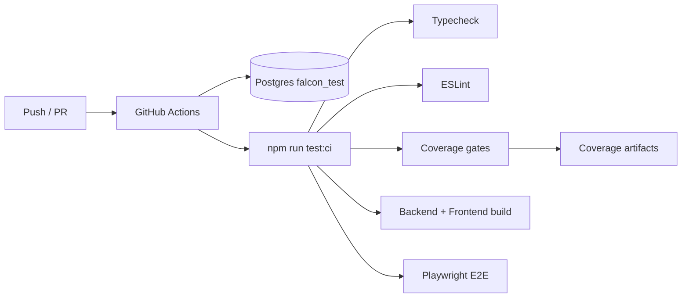

# Falcon Campus OS — Developer Guide

Practical setup and day-to-day development for the SGVU Campus OS monorepo.

The team branch model is `feature/*` or `fix/*` → reviewed PR into `staging`
→ shared testing → reviewed release PR into `main`. The shared environment and
its automation are not yet operational. See [STAGING_READINESS.md](./STAGING_READINESS.md)
for the current prerequisites and the pending work in
[PR #188](https://github.com/shodh-ai/Falcon/pull/188).

---

## Prerequisites

| Tool | Version | Notes |
|------|---------|-------|
| Node.js | 20.x, at least 20.19 | Most CI jobs and Dockerfiles use 20; notification security CI uses 22.23.3 |
| PostgreSQL | 16.x for the general local/CI fixture; 18 for the protected shared-runtime policy | Use a disposable local database. The isolated runtime-role CI fixture and reviewed shared staging policy require PostgreSQL 18. |
| Redis | 6+ | Required for BullMQ background jobs |
| MinIO (optional) | — | S3-compatible uploads; disk fallback available |

---

## Quick start (local)

Use disposable local PostgreSQL, Redis and uploads with synthetic data only.
Before starting the backend, obtain a separately reviewed local schema and
synthetic fixture setup for that exact database. This guide does not supply a
bootstrap command: historical migrations include data changes and resets, and
replaying the directory is not a verified fresh schema baseline. These commands
are not a shared-staging or production setup procedure. Keep actual credentials
out of Git; example configuration does not establish a safe target.

```bash
# Clone and enter repo
cd Falcon

# Backend
cd backend
cp .env.example .env
npm install
# Configure local-only values and finish the separately reviewed disposable schema setup first.
npm run start:dev          # builds TS → runs on :4000

# Frontend (new terminal)
cd frontend
npm install
npm run dev                # :3000
```

Open `http://localhost:3000`. API at `http://localhost:4000`.

### Dev login

For an isolated local backend with `NODE_ENV=development`, the development route
can log in an existing, active synthetic account in the selected local tenant.
It does not create that account. For example, after a reviewed local fixture setup
creates the fictional `developer@example.test` account:

```bash
# GET (browser or curl)
http://localhost:4000/auth/dev-login/developer@example.test
```

The route bypasses password authentication and can update role mappings; keep the
local backend inaccessible to other users. Shared staging and production must use
`NODE_ENV=production`, where this route is disabled. Never lower that setting to
enable development login. Use `POST /auth/local-login` with separately provisioned
synthetic credentials for approved local/shared-staging password-login tests.

---

## Environment variables

### Backend (`backend/.env`)

Copy from `backend/.env.example`. Critical variables:

| Variable | Purpose | Example |
|----------|---------|---------|
| `DB_HOST`, `DB_PORT`, `DB_USERNAME`, `DB_PASSWORD`, `DB_DATABASE` | PostgreSQL | `localhost:5434` |
| `JWT_SECRET` | Token signing | Generate separate private values for local development, shared staging and production |
| `JWT_EXPIRATION` | Token TTL | `7d` |
| `DEFAULT_TENANT_SUBDOMAIN` | Default tenant | `sgvu` |
| `SAAS_BASE_DOMAIN` | Multi-tenant host | `localhost` |
| `FRONTEND_URL` | OAuth redirect target | `http://localhost:3000` |
| `GOOGLE_CLIENT_ID/SECRET` | Google SSO | From Google Cloud Console |
| `ALLOWED_DOMAIN` | Email domain filter | `mygyanvihar.com` |
| `REDIS_HOST`, `REDIS_PORT` | BullMQ | `127.0.0.1:6380` |
| `S3_*` | File uploads | MinIO defaults |
| `EMAIL_*` | External email configuration | Does not enable Examination Cell delivery |
| `GEMINI_API_KEY` | AI document validation | Optional locally |
| `DB_SYNCHRONIZE` | Must be `false` in shared staging and production | Review schema changes separately; do not enable synchronization to bypass missing schema |
| `DB_POOL_MAX`, `DB_POOL_MIN` | Connection pool | See PERFORMANCE.md |

### Examination Cell first-release delivery limits (22 October 2026)

`EMAIL`, `SMS` and `WHATSAPP` Examination Cell campaigns fail closed with **503**:
the external delivery adapters currently log/stub delivery. Credentials alone do
not enable them. `IN_APP` campaign persistence and student retrieval were verified
using synthetic data in the disposable local environment only.

The product owner selected in-app notifications only for the first release.
External notification channels stay disabled; DigiLocker is deferred. Payment
capture/settlement and OTP delivery still need safe provider sandbox verification;
synthetic settlements and local logins do not verify external delivery.

The local backup restore and three reviewed forward migrations passed in the
explicitly approved disposable recovery database on 22 October. No production
database was accessed. Target infrastructure, private storage, HTTPS, secrets,
backups and the production migration ledger remain deployment-specific checks;
see the first-release scope and unsupported workflows in DEPLOYMENT_GUIDE.md.

Set API URL via environment:

| Variable | Purpose | Default (local) |
|----------|---------|-----------------|
| `NEXT_PUBLIC_API_URL` | Client-side API base | `http://localhost:4000` |
| `API_URL` | Server-side; injected as `window.__FALCON_API_URL` | same |
| `NEXT_PUBLIC_DEFAULT_TENANT_SUBDOMAIN` | Tenant fallback | `sgvu` |
| `NEXT_PUBLIC_SAAS_BASE_DOMAIN` | Subdomain parsing | — |
| `NEXT_PUBLIC_EXAM_CELL_DEV_FALLBACK` | Exam Cell mock data | `'true'` in dev only |
| `NEXT_PUBLIC_STUDENT_DEMO_MODE` | Student Portal empty-API smoke data | off (`true`/`1`/`on` to enable) |
| `NEXT_PUBLIC_STUDENT_LIBRARY_LAUNCHED` | Enables the student Library page and due/overdue dashboard warning | off (`true`/`1`/`on` to launch; rebuild frontend after changing) |
| `NEXT_PUBLIC_FACULTY_DEMO_MODE` | Faculty Portal empty-API smoke data | on in `development` by default; `false`/`0`/`off` to disable; `true`/`1`/`on` to force on |

Implementation: `frontend/src/lib/api-base-url.ts`, `frontend/src/middleware.ts`.

---

## Branch strategy

| Branch | Purpose |
|--------|---------|
| `main` | Production-ready releases |
| `staging` | Shared integration branch for reviewed features and fixes |
| `feature/<ticket>-short-description` | New work, branched from `origin/staging` |
| `fix/<ticket>-short-description` | Bug fixes, branched from `origin/staging` |

Existing `develop` and `testing` branches are retained; new team work follows
`staging`. Check [staging readiness](./STAGING_READINESS.md) before starting work
against an older staging baseline. Synchronizing `main` into `staging` requires
a reviewed PR; do not reset either branch or discard newer checks.

From a clean checkout, create a separate branch:

```bash
git fetch origin
git switch --create feature/my-feature origin/staging
# Make changes, run appropriate checks, and review git diff.
git add path/to/changed-file
git commit -m "Describe the change"
git push --set-upstream origin feature/my-feature
```

Replace the example path and branch name. For bugs, use `fix/my-bug` instead.
Open a GitHub Pull Request with **base: staging** and your feature/fix branch as
the compare branch. Attach actual test results and request a teammate's review.
Developers do not push unreviewed changes directly into `staging` or `main`.

The CI extension for `staging` is still pending in PR #188. Until it is reviewed
and merged, this branch's workflow triggers only for `main`, `develop` and
`testing`; missing checks are not passing checks. Do not bypass protection to
merge a feature while the required staging checks are unavailable. No shared
staging website or PR preview is verified; record local evidence and state that
no deployed test was performed.

After staging CI and hosting are approved and configured, reviewed merges into
`staging` must pass CI on the resulting commit. The team then tests that exact
revision in the isolated shared environment and records the results. Release
through a reviewed `staging` → `main` PR, identifying the tested revision and
database compatibility. Obtain separate production release authorization and
confirm hosting triggers before a `main` merge; that merge can publish production
images through the existing workflow. A green PR alone does not authorize deployment.

- Run the relevant checks, including `cd tests && npm run test:ci` only with its disposable test services. Report anything not run.
- Database migrations are forward-only; never edit applied migration files. Review deployment order and recovery separately.
- RBAC-sensitive changes require unit or integration test updates in `tests/`.
- Fix staging bugs through `fix/*` and the same PR process. An approved urgent production fix must return to staging through a reviewed synchronization PR.
- Roll back only to a verified image/configuration pair after checking schema compatibility. A Git revert does not reverse database changes.

---

## Coding standards

| Area | Convention |
|------|------------|
| Backend routes | `@Controller('api/<module>')` + `@Roles()` on every protected handler |
| Scope checks | Dean/HOD services must call `resolveDeanScope()` / dept filter before return |
| Exam Cell mutations | Call `assertExamCellAction()` before publish/declare/UFM |
| Frontend portals | Update `navigation.ts` + `auth-routing.ts` when adding routes |
| Migrations | `YYYYMMDDHHMMSS_description.sql` in `backend/migrations/` |
| Tests | Add to `tests/` unified suite; no duplicate smoke specs |
| Lint | ESLint 9 flat config; CI lints test infrastructure paths |

TypeScript strict mode enabled in backend and frontend. Backend builds with `tsc -p tsconfig.build.json` (not `nest build`).

---

## CI/CD



**Workflow:** `.github/workflows/falcon-tests.yml`

At this staging baseline, push/PR triggers cover `main`, `develop` and `testing`.
PR #188 proposes adding `staging` while retaining existing checks. Its staging
image publisher is an inactive template, not an enabled deployment workflow.
See [STAGING_READINESS.md](./STAGING_READINESS.md) before interpreting CI success
as readiness for shared staging or production.

**Local verification with disposable test services:**

```bash
cd tests && npm run test:ci
```

**Artifacts uploaded:** `coverage-unit`, `coverage-integration`, `coverage-frontend`, `playwright-report`

See [TESTING_GUIDE.md](./TESTING_GUIDE.md) for coverage thresholds and test layout.

---

## Database migrations

All schema changes are **SQL files** in `backend/migrations/`.

The command below is for an explicitly selected disposable local database after
reviewing all pending SQL. It can change or delete data. Shared staging requires
a separately reviewed baseline and migration sequence; production uses its
authorized deployment procedure. Never substitute production credentials for an
incomplete local setup.

```bash
cd backend

# Apply pending migrations
npm run db:migrate
```

Do not use migration repair, force/replay or seed commands as a generic recovery
step. Inspect the actual schema and ledger, preserve failure evidence, and obtain
review of the target and recovery plan first. Seed/import scripts can contain
institution data; they are not an approved synthetic staging fixture set.

### Historical pilot migration references

These filenames document earlier pilot work. Their presence here does not
approve execution on a new local, shared staging or production database.

| Migration | Purpose |
|-----------|---------|
| `20260717100000_exam_result_dean_approval_requests.sql` | Dean result approval tables |
| `20260713140000_me_timetable_workload_seed.sql` | Mechanical Engineering seed |
| `20260710120000_dean_school_scope_mapping.sql` | Dean ↔ school mapping |

### Historical department and demo tools — not approved setup

These tools were written for particular pilot datasets. Inspect their inputs,
target and effects separately before any authorized use; they are not the
synthetic fixture procedure for a new developer or shared staging environment.

| Historical tool in `backend/scripts/` | Scope and limitation |
| --- | --- |
| `verify-me-seed.js` | Opens a database connection using `DB_*` or its defaults and reads institution records. Do not run it as generic setup verification. |
| `build-me-seed-data.py`, `generate-me-migration.py` | Prepare department data/SQL from pilot inputs; neither the inputs nor generated SQL are approved synthetic staging fixtures. |
| `generate-enterprise-demo-seed.js` | Writes demo SQL without a database connection. Generated SQL still needs target, schema, data and credential review before any execution. |

Similar pipelines exist for Civil, EE, Pharmacy, Physio (`build-*-seed-data.py`).
No command in this historical inventory is authorized by the staging setup.

---

## Build commands

| Location | Command | Output |
|----------|---------|--------|
| `backend/` | `npm run build` | `dist/` (tsc) |
| `backend/` | `npm run start:prod` | Direct `node dist/main.js`; skips the protected launcher and is unsuitable for shared staging or production |
| `frontend/` | `npm run build` | `.next-local/` build output, including a standalone server; not a static export |
| `frontend/` | `npm run start` | Existing local `next start` script for the built frontend |

Backend uses `tsc -p tsconfig.build.json` (not `nest build`).
The backend Docker image starts with `node scripts/runtime-start.cjs`, which
verifies the provisioned storage/database boundary before loading the app.
Preserve that command for shared staging and production; it does not migrate or
bootstrap the database. The frontend Docker image copies `.next-local/standalone`
and the matching static assets, then runs `node server.js`.

---

## Folder conventions

### Backend

```
backend/src/modules/<feature>/
  ├── <feature>.module.ts
  ├── <feature>.controller.ts   # HTTP routes
  ├── <feature>.service.ts      # Business logic
  ├── dto/                      # class-validator DTOs
  └── *.util.ts                 # RBAC / scope helpers
```

- **Controllers** use `@Controller('api/...')` for feature APIs.
- **Guards:** `JwtAuthGuard` + `RolesGuard` on protected routes.
- **Entities** live in `src/entities/` (shared across modules).
- **Cross-cutting:** `src/core/` (audit, notifications, workflow).

### Frontend

```
frontend/src/app/(portals)/<portal>/<route>/page.tsx
frontend/src/components/<domain>/   # Reusable domain UI
frontend/src/lib/                     # navigation, auth-routing, API
```

- Portal layouts wrap pages with `RoleGate`.
- Navigation defined once in `lib/navigation.ts`.
- Role routing in `lib/auth-routing.ts` — update both when adding portals.

### Tests

```
tests/
  unit/           # Pure logic (RBAC, pagination, dean scope)
  integration/    # Module wiring, API contracts
  e2e/            # Playwright browser tests
```

Run from `tests/` — see [TESTING_GUIDE.md](./TESTING_GUIDE.md).

---

## Common development tasks

### Add a new API endpoint

1. Add method to `*.controller.ts` with `@Roles(...)`.
2. Implement in `*.service.ts` with tenant + scope checks.
3. Add DTO in `dto/` if accepting body/query.
4. Wire frontend API client + page.
5. Add integration test if security-sensitive.

### Add a portal nav item

1. Edit `frontend/src/lib/navigation.ts` (portal's `navGroups`).
2. Create page under `app/(portals)/<portal>/`.
3. Update `portalRoles` in `auth-routing.ts` if new portal prefix.

### Add a migration

1. Create `backend/migrations/YYYYMMDDHHMMSS_description.sql`.
2. Review all pending SQL and test it on a disposable local database, including failure and recovery behavior.
3. Document in CHANGELOG and MECHANICAL_PILOT_LAUNCH_CHECKLIST if pilot-critical.

---

## Troubleshooting

### Backend won't start

| Symptom | Fix |
|---------|-----|
| `ECONNREFUSED` PostgreSQL | Check `DB_HOST`/`DB_PORT`; default example uses `5434` |
| Migration fails | Stop; compare the schema and ledger with the intended SQL and review recovery. Do not blindly repair tracking or replay migrations. |
| Redis connection errors | Start Redis or disable Bull-dependent features locally |
| `JWT malformed` | Clear the stale browser token and use the environment's normal login. Development login is only for the isolated local setup described above. |

### Frontend 403 on portal routes

- Confirm user role in `/auth/me`.
- Check `canRoleAccessPath()` in `auth-routing.ts`.
- Verify `launch-modules.ts` hasn't hidden the route for pilot.

### Dean/HOD sees wrong department data

- Verify `schools.dean_user_id` and `departments.hod_user_id` in DB.
- Compare the actual schema and migration ledger with the intended dean scope change (`20260710120000_dean_school_scope_mapping.sql`). Review the pending sequence before any write; do not blindly replay it.
- Test: `cd tests && npm run test:unit -- dean-scope`.

### Exam Cell 403 on publish

- Expected for `ExamAdmin` / `ExamOperator`.
- Check role with `assertExamCellAction()` matrix.
- COE needs `ExamCell` or `DeputyCOE` role.

### Grade-card PDF verification

- Apply `20261019113000_grade_card_verifications.sql` through the normal migration runner.
- Set `GRADE_CARD_VERIFICATION_BASE_URL` to the publicly reachable HTTPS API origin, without a path, query, or credentials. Explicit loopback HTTP origins are accepted for disposable local tests only.
- Published `PROVISIONAL` and `FINAL` grade-card PDFs receive a real QR code. Its opaque token is stored only as a hash; the public endpoint exposes document type, semester, publication stage, and issue date, without student details, grades, or PDF links.
- Every scan checks the current tenant-bound grade card and revision. Withholding, open locked UFM cases, revocation, or changed records invalidate an issued QR. Publication validity is checked online; the QR is not an offline academic signature.
- Authenticated staff previews stay available when the card is unpublished or the verification URL/storage is unavailable, with an explicit unverified notice and no QR. Public deployment also requires the existing edge request protections; no default origin or signing secret is assumed.

### CORS / cookie issues

- Align `FRONTEND_URL` with actual frontend origin.
- Production: configure reverse proxy cookie domain.

### Slow list endpoints

- See [PERFORMANCE.md](./PERFORMANCE.md) for pooling, indexes, Redis cache keys.

---

## Useful scripts

| Script | Purpose |
|--------|---------|
| `backend/scripts/run-migrations.js` | Migration runner |
| `backend/scripts/audit-db.js` | DB health audit |
| `backend/scripts/verify-me-seed.js` | Historical ME pilot DB reader; not generic setup verification |
| `backend/scripts/generate-enterprise-demo-seed.js` | Historical demo SQL generator; generated fixtures are not approved for staging |

---

## Documentation index

| Doc | Topic |
|-----|-------|
| [ARCHITECTURE.md](./ARCHITECTURE.md) | System design |
| [API_REFERENCE.md](./API_REFERENCE.md) | REST endpoints |
| [TESTING_GUIDE.md](./TESTING_GUIDE.md) | Test suite (Phases A–B.1) |
| [STAGING_READINESS.md](./STAGING_READINESS.md) | Staging prerequisites, pending PR #188, and current setup limits |
| [SECURITY_GUIDE.md](./SECURITY_GUIDE.md) | RBAC & hardening |
| [DEPLOYMENT_GUIDE.md](./DEPLOYMENT_GUIDE.md) | Production deploy |
| [PROJECT_ROADMAP.md](./PROJECT_ROADMAP.md) | Future work |
| [DOCUMENTATION_COVERAGE_REPORT.md](./DOCUMENTATION_COVERAGE_REPORT.md) | Phase C audit |
| [SYSTEM_MAP.md](./SYSTEM_MAP.md) | Roles & workflows |

---

*For production go-live, follow [MECHANICAL_PILOT_LAUNCH_CHECKLIST.md](./MECHANICAL_PILOT_LAUNCH_CHECKLIST.md).*
