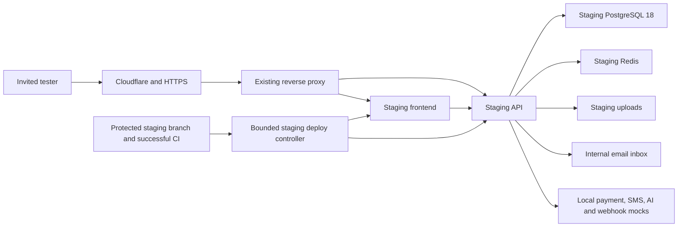

# FALCON staging

This package prepares an isolated, owner-invited staging environment on the existing server. It does not deploy production. Activation remains disabled until the protected staging branch, capacity gates and live acceptance checks pass.

## Separation

- Hostnames: `staging-falcon.jataka.io` and `staging-apifalcon.jataka.io`. Both DNS records point to the existing server through Cloudflare. Certificate issuance still requires a live acceptance check.
- Only `/data/falcon-staging/` is mounted into staging workloads. No production uploads, backups, database volumes, credentials or Docker socket are mounted there.
- PostgreSQL and Redis have no published ports. Docker networks are internal and IPv6 is disabled. Source-scoped firewall rules block new connections to production, the shared proxy interface, host administration and the Internet. Production firewall chains are retained.
- Frontend requests and SSR use explicit staging API addresses. Browser policy limits API/WebSocket connections to staging. A persistent dummy-data banner identifies the environment.
- Staging uses independent signing/encryption keys and host-only cookies. Its hardened launcher verifies mount identities and a non-owning runtime database role before starting the API. Migrations run separately.
- Initially only the synthetic owner account is active and invited. An owner-controlled, read-only invite file is checked on login, authenticated requests and WebSocket handshakes. Public registration and production OAuth are disabled. Invite and activate additional synthetic testers only through reviewed owner maintenance.

## Preparation and activation order

1. Capture production container IDs, image identities, mount mappings, health, configuration hashes and capacity. Complete a fresh production backup. Store sensitive evidence in the server's protected audit directory.
2. Install a reviewed immutable version under `/opt/falcon-staging/versions/`, owned by root, directory mode `0700`, source files `0444`. Include `ops/deployment-safety/runtime-role.sql` as `runtime-role.sql` beside the Python/Node helpers. Point the root-owned `current` symlink only at a reviewed version.
3. Run `prepare.py` as owner. It exports only the reviewed public schema and migration-ledger filenames, checks external-connection objects and generates entirely new staging credentials. Preserve its source export hash. Never copy business records or historical data seeds.
4. Run `bootstrap.py` as owner with immutable official data-image digests and the captured production API image identity for the isolated seed helper. It creates the separate Coolify project, private networks, staging-only firewall hooks and data containers. It imports the schema into staging, creates the restricted runtime role, generates synthetic records/PDFs, and stops the data containers with storage retained. Existing `public` schema handling changes only the exact `CREATE SCHEMA public;` declaration; the original export remains intact.
5. Review and merge the infrastructure/code PR into the protected `staging` branch. Required checks and independent review remain enforced. CI publishes separate `falcon-staging-backend` and `falcon-staging-frontend` packages. Never publish these builds as production candidates or use unprotected PR images for live staging.
6. Install the root-owned watchdog service/timer before any application startup. Use the reviewed first-release entry point with an owner-only `initial-approved-release.json` pinning both image digests, source SHA and the successful protected-branch CI run. It bypasses only the initial acceptance gate; resource, production identity, schema, storage and network guards still apply.
7. Complete every acceptance category below and retain server-side evidence. Write `acceptance-evidence.json` and its hashed `acceptance.json` only after the actual tests pass. The deployer rejects an incomplete report or a lone `enabled: true` flag.
8. Create the dedicated staging deploy account and key. No Docker/root group membership or writable authorized-key configuration is allowed. The forced SSH wrapper accepts only the literal `deploy` command. Its sole sudo rule runs the fixed bounded request service, with no arguments, arbitrary commands, SQL, reset or production authority. Validate sudoers with `visudo -cf` before installation.
9. Store that staging-only private key in the GitHub `staging` environment; pin the server host key in `STAGING_SSH_KNOWN_HOSTS` and set the staging-only `STAGING_SSH_HOST`/`STAGING_SSH_PORT` environment variables. Configure the environment for the protected `staging` branch. Enable `STAGING_DEPLOYMENT_ENABLED` only after all checks pass. Production promotion stays manual.

Do not use Coolify's generic Start/Restart action for this resource: it bypasses the guarded release controller. Do not restart the shared proxy to activate staging; its file provider reloads the staging-only route file.

## Capacity and deployment

Memory ceilings: API 768 MiB, frontend 512 MiB, PostgreSQL 512 MiB, Redis 128 MiB, inbox 64 MiB. CPU ceilings, low CPU scheduling weight, no swap, no capabilities, a read-only root filesystem and bounded temporary filesystems apply. The API database pool is five connections.

Initial startup requires at least 4 GiB available host memory. Running staging requires a 1.5 GiB reserve. A replacement also requires room for the API/frontend candidates while the old release stays alive. Disk must exceed the greater of 20 GiB and three working sets. Capacity failures defer deployment. The minute watchdog stops only registered staging containers if reserve, network or production safety checks fail; storage is preserved. Nothing stops production to make space.

Docker restart policies are deliberately off. After a host reboot, staging remains off until an owner revalidates production identities, reinstalls/verifies network guards and checks headroom. No container can start before the firewall through a restart policy.

The controller validates short-lived GitHub OIDC signatures and exact repository, protected branch, push event, workflow, environment, source SHA and digest-bound audience. Identities cannot be reused. Older workflow run numbers cannot replace a newer successful staging release. Deployments are serialized. Candidate health, public release headers and production checks must pass before the old staging release is stopped. Failure restores only the prior staging route and stops the candidate; no volume deletion occurs.

A legitimate independent production release invalidates the captured production baseline and holds staging operations. An owner must inspect and record the replacement identities/mounts before resuming; the controller never refreshes that baseline automatically.

## Integrations and maintenance

All staging email, including direct password-reset mail, targets the internal inbox using mandatory STARTTLS and a separate CA. No forwarding is configured. Inbox storage is persistent and has no automatic message deletion. Payment flows use local mocks. AI gives explicitly labeled dummy responses without a provider call. SMS, WhatsApp, government pushes and outbound webhook publishers retain local mock receipts under the staging uploads tree. Webhook events are acknowledged only after capture. Network egress remains blocked even if application configuration is wrong.

Runtime credentials cannot own or alter tables, schemas or migration history. Pending migrations hold a deployment. `maintenance.py --reviewed-manifest` is a local root-only job for at most ten individually hashed, non-seed SQL files, a verified staging PostgreSQL ID and the exact staging storage path. Simple migrations must omit outer transaction wrappers and psql commands. It runs bounded SQL and reapplies the reviewed staging runtime policy. Complex migrations require a separate owner review; never grant DDL to the API.

`reset.py --owner-approved-preserve-reset` is local owner maintenance only. Its exact target approval must match the current staging PostgreSQL ID, database, release and four storage paths. Production identities/paths are rejected. It stops staging, removes only staging routes, disables acceptance, and moves the entire old dummy-data generation into protected preservation storage. It deletes no data. After a reset, bootstrap, migrations, reviewed initial release and acceptance must be repeated. No reset or purge API exists.

Owner login details belong only in `/data/falcon-staging/private/owner-login.txt`, mode `0600`. Never paste credentials into chat, CI logs or repository files. Keep production restorations and personal data off developer machines.

## Required live acceptance evidence

- Staging cannot connect to production services, host administration, the proxy as an egress relay, or external integrations.
- Staging database credentials are independent and absent from production; authentication in the wrong environment fails.
- Tokens fail across environments. Non-invited, inactive and cross-tenant/resource cases are denied over HTTP and WebSockets.
- Dummy users, uploads, course materials, assignments and tests affect staging only. Production has no staging-created synthetic tenant/user IDs.
- Browser requests, SSR, downloads and WebSockets use staging endpoints. The banner, CORS, cookies and TLS are correct.
- Every email path reaches only the internal inbox; payment, SMS, AI and webhook tests cause no external action.
- Actual runtime credentials cannot change schema, ownership or migration history.
- Replace staging containers and verify unchanged database and upload contents/hashes.
- Reset target validation rejects production identities and paths. Exercise the preserve-reset lifecycle only on synthetic staging.
- Production health and mounts remain unchanged and capacity reserve holds throughout.

Keep staging disabled on any failed or unproven category. Local unit tests and a healthy `/health` response alone do not establish this evidence.

## Current rollout checkpoint — 30 October 2026

DNS resolves through Cloudflare. A separate Coolify staging project and new storage/credentials were prepared. The schema-only baseline contains 379 migration filenames. A fresh production backup completed at 12:31 UTC. Initialization encountered the existing-public-schema conflict; the source correction was tested. Subsequent startup attempts were refused by the unchanged 4 GiB memory gate while available memory fluctuated around the threshold. The three staging data containers were stopped and their files retained. The synthetic import and application acceptance are **not proven**.

No staging application route, live frontend/API deployment, automatic deployment, deploy SSH credential or GitHub activation flag has been enabled. The watchdog, first-release, maintenance and reset helpers in this PR have local tests but are not installed or live-tested. Production container identities, mount mappings, configuration hashes and public health checks matched the refreshed baseline after preparation. An unrelated production release occurred during setup; its reviewed identities replaced the earlier baseline in protected history. A later independent API replacement was also observed: it was healthy with identical upload mounts. The saved production baseline must be revalidated before staging work resumes.
